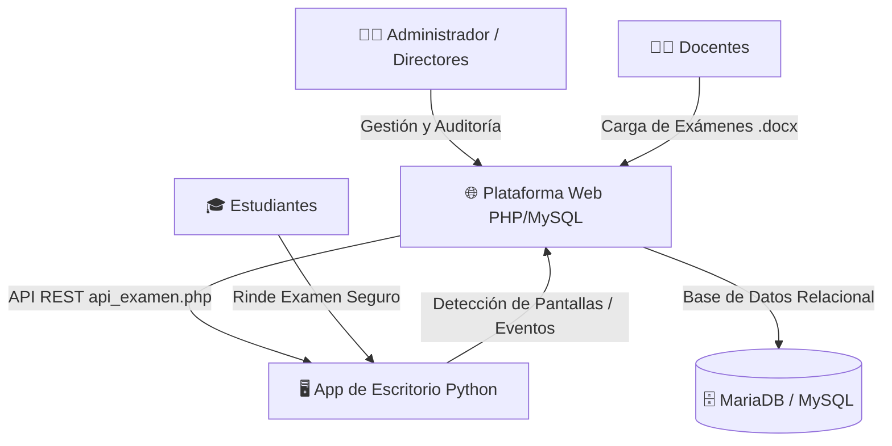

# 🎓 Sistema Web de Gestión y Supervisión Segura de Exámenes Académicos

> **Proyecto de Tesis de Grado**  
> **Institución:** Universidad de Guayaquil (UG)  
> **Facultad:** Facultad de Ciencias Matemáticas y Físicas  
> **Carrera:** Licenciatura / Ingeniería en Tecnologías de la Información  


---

## 📌 Descripción del Proyecto

El **Sistema de Exámenes UG** es una solución tecnológica integral diseñada para optimizar, automatizar y asegurar el proceso de evaluación académica en la educación superior. 

Integra una **plataforma web administrativa y docente** con una **aplicación cliente de escritorio (en Python)** que incorpora mecanismos de supervisión activa y control anti-fraude (detección de pantallas y periféricos de salida externos), garantizando la transparencia e integridad de las evaluaciones en línea.

---

## 🏛️ Arquitectura del Sistema

El ecosistema se divide en tres componentes principales interconectados:



1. **Plataforma Web (PHP/MySQL):**
   * Panel para **Administradores**, **Directores de Carrera**, **Directores de Área**, **Docentes** y **Estudiantes**.
   * Importador masivo de planificaciones institucionales desde hojas de cálculo Excel (`.xlsx`).
   * Motor de procesamiento y extracción de preguntas, opciones e imágenes a partir de documentos Word (`.docx`).
   * Módulo de auditoría de seguridad y trazabilidad en tiempo real.

2. **Aplicación de Escritorio - Examen Seguro (Python):**
   * Interfaz interactiva estilo Moodle para la toma de exámenes.
   * Comunicación en tiempo real con el servidor mediante API REST JSON.
   * **Módulo de Seguridad Anti-Fraude:** Supervisión de hardware en tiempo real que detecta si el estudiante tiene dos o más pantallas / salidas de video conectadas. En caso de irregularidad, bloquea la prueba, asigna automáticamente nota 0 y genera una alerta inmediata.

3. **Banco de Formatos y Plantillas:**
   * Archivos modelo estandarizados para planificaciones, nóminas de docentes, estudiantes y reactivos de prueba.

---

## 🚀 Funcionalidades Principales

### 👨‍💼 1. Módulo Administrador (`admin.php`)
* **Gestión de Ciclos y Cursos:** Importación automática de carreras, semestres, asignaturas y paralelos vía Excel.
* **Control de Usuarios:** Aprobación de cuentas, gestión de roles y forzado de cambio de contraseña temporal.
* **Historial de Auditoría (`secciones/historial.php`):** Registro de todas las acciones del sistema con filtros avanzados por actor, tipo de acción y fechas.
* **Supervisión de Evaluaciones Docentes:** Seguimiento del cumplimiento de evaluaciones por materia y área.

### 👨‍🏫 2. Módulo Docente (`docente.php`)
* **Creación Automática de Exámenes desde Word (.docx):**
  * Parser nativo que interpreta preguntas, opciones `A)`, `B)`, `C)`, `D)` y extrae imágenes incrustadas.
* **Parámetros de Evaluación:**
  * Configuración de duración en minutos, parcial, fechas programadas y modalidad secuencial/libre.
  * Ponderación inteligente de puntajes (mayor valor asignado a preguntas que incluyen diagramas/imágenes).
  * Control de publicación de notas y permisos de revisión post-evaluación.
* **Distribución de la App:** Configuración del enlace de descarga para los estudiantes.

### 🎓 3. Módulo Estudiante (`estudiante.php` / `revisar_examen.php`)
* Consulta de calificaciones y asignaturas matriculadas.
* Descarga de la aplicación oficial de evaluación.
* Revisión guiada de respuestas correctas/incorrectas tras el cierre del examen (si el docente lo autorizó).

### 🛡️ 4. API de Exámenes y Seguridad (`api_examen.php`)
* `login`: Autenticación segura del estudiante.
* `examenes` y `preguntas`: Entrega de cuestionarios aleatorizados individualmente.
* `verificar_tiempo`: Polling periódico para sincronizar el cronómetro del examen con el servidor.
* `guardar_respuesta`: Guardado asíncrono para prevenir pérdida de respuestas ante cortes de red.
* `finalizar_examen`: Procesamiento final de notas y forzado de calificación 0 ante eventos de seguridad (`salida_video_externa`).

---

## 📂 Estructura del Repositorio

```text
├── admin.php                    # Panel principal de administración
├── admin_logic.php              # Lógica de negocio del módulo administrativo
├── api_examen.php               # API REST para comunicación con la app cliente
├── db.example.php               # Plantilla de configuración de base de datos
├── docente.php                  # Panel del docente y creación de exámenes
├── docente_core.php             # Funciones núcleo, parser de Word .docx y utilidades
├── docente_queries.php          # Consultas SQL optimizadas para el módulo docente
├── estudiante.php               # Portal de estudiantes
├── revisar_examen.php           # Vista de revisión de exámenes contestados
├── estilos.php                  # Hojas de estilo unificadas y diseño visual UG
├── scripts.php                  # Librerías JavaScript comunes
├── if0_40427719_examenes_sistem.sql # Estructura y volcado completo de la base de datos
├── apk python/              # Código fuente de la app de escritorio en Python
│   ├── examen_seguro.py         # Aplicación cliente completa con detector de seguridad
│   ├── Imagenes/                # Íconos y logotipos oficiales de la UG
│   ├── examen_seguro.spec       # Archivo de especificación para empaquetado PyInstaller
│   └── README.md                # Instrucciones de compilación y ejecución de la app
├── formatos/                    # Plantillas oficiales en Excel y Word
│   ├── 2025-2026 CII Formato.xlsx
│   ├── Areas Tics Formato.xlsx
│   ├── Docentes Formato Tics.xlsx
│   ├── Estudiantes Formato 1.xlsx
│   ├── Test Formato 2 Herramientas Digitales.docx
│   └── README.md
└── secciones/                   # Vistas modulares del panel de administración
    ├── cursos.php
    ├── docentes_evaluaciones.php
    ├── historial.php
    ├── notas.php
    └── usuarios.php
```

---

## 🛠️ Puesta en Marcha (Instalación Local)

### 1. Requisitos
* Servidor Web local: **XAMPP**, **WampServer** o **LAMP** (PHP 7.4 o superior con extensiones `mysqli`, `zip` y `mbstring`).
* Gestor de Base de Datos: **MySQL 5.7+** o **MariaDB 10.4+**.
* **Python 3.10+** (para la aplicación de escritorio).

### 2. Configurar la Base de Datos
1. Abre **phpMyAdmin** (o tu gestor MySQL preferido).
2. Crea una base de datos llamada `if0_40427719_examenes_sistem` (o el nombre que prefieras).
3. Importa el archivo SQL incluido en la raíz:
   ```bash
   mysql -u root -p if0_40427719_examenes_sistem < if0_40427719_examenes_sistem.sql
   ```

### 3. Configurar la Conexión Web
1. Copia el archivo `db.example.php` como `db.php`:
   ```bash
   cp db.example.php db.php
   ```
2. Edita `db.php` con tus credenciales locales:
   ```php
   $DB_HOST = 'localhost';
   $DB_USER = 'root';
   $DB_PASS = '';
   $DB_NAME = 'if0_40427719_examenes_sistem';
   ```

### 4. Ejecutar la Aplicación de Escritorio
En una terminal:
```bash
cd apk python
pip install requests pywin32 pillow
python examen_seguro.py
```

---

## 👥 Roles Predeterminados (Datos de Prueba)

| Rol | Usuario de Prueba | Descripción |
| :--- | :--- | :--- |
| **Administrador** | Cédula registrada en BD | Control total de planificaciones, auditoría y usuarios |
| **Docente** | Cédula docente en BD | Creación de cuestionarios, configuración y monitoreo |
| **Estudiante** | Cédula estudiante en BD | Acceso a evaluaciones y visualización de notas |

*(Nota: Las contraseñas iniciales corresponden a la cédula de cada usuario registrada en el archivo SQL).*

---

## 📄 Licencia y Derechos

Desarrollado como proyecto de titulación en la **Universidad de Guayaquil**. Todos los derechos reservados con fines académicos y de investigación.
